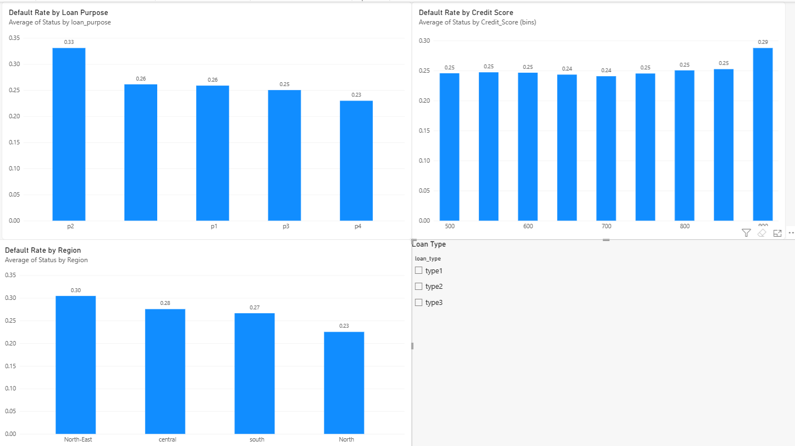

# Loan Default Dashboard (Power BI)

## Problem
Which loan purposes, credit score groups, and regions have the highest default rates?

## Data
Kaggle "Loan Default Dataset" (Loan_Default.csv, about 149,000 rows). The Status column is 0/1. The dataset does not define it, so I assumed 1 = default, based on the dataset's goal of predicting defaults.

## Tools
Power BI Desktop

## What I did
- Loaded the CSV into Power BI
- Built 3 charts of average default rate by loan purpose, credit score group, and region
- Added a loan type filter (slicer)

## Key findings
1. Loan purpose p2 has the highest default rate (33%); the others are 23-26%.
2. Default rates are fairly flat (about 24-25%) across credit score groups from 500 to 800. The 900 group has very few loans, so its rate is not reliable.
3. North-East has the highest default rate (30%), and North the lowest (23%).
4. For type3 loans, p2 jumps to 89%, which is worth investigating.

## Limitations
- Some loan_purpose values are blank, so one bar has no label.
- Status meaning is assumed, not confirmed.

## Next steps
Add SQL queries and a Python (pandas) analysis of the same data.

## Screenshots

